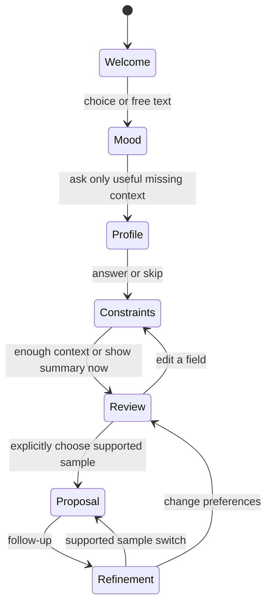

# ADORA AI Travel Concierge — UX Specification v1

Date: 2026-11-21. Status: **proposed UX-1 contract; not implemented**.
Baseline: `54cab5bc5d04af4ec790493d725baf4d140483b7`.

## Existing implementation and migration

`apps/web/src/components/layout/site-header.tsx` has a desktop Link and mobile-menu Link to `/ai-planner`; the mobile link closes the menu. Hero, AI introduction, footer, discovery Planner CTA and trip pages also link there. `components/layout/site-shell.tsx` contains another legacy link; confirm whether a route mounts it before changing it. Audit every live entry point, not only the header.

`app/ai-planner/page.tsx` builds previews from `lib/demo/trips.ts` for `components/planner/planner-workspace.tsx`. That client component owns messages, active scenario, draft, menu state and focus/scroll refs. `lib/demo/planner-scenarios.ts` matches exact normalized prompts/aliases for two Đà Lạt examples: three days and a calm two-day weekend. Unsupported text gets an explicit scripted limitation. Replies are inserted without network generation or fake typing delay. The polite message log, IME guard and restrained application motion are valuable foundations.

Recommend **A: preserve `/ai-planner` as the expanded workspace**, also serving the accessible URL fallback. It shares one reducer with the dialog. Reject modal-only route replacement and defer intercepted-route machinery. Existing URLs and internal trip links continue working; existing demo content is adapted rather than silently replaced with fabricated capabilities.

## Entry-point map and navigation semantics

```text
Header CTA ─┐
Mobile CTA ├─ unmodified activation → openConcierge(origin, optional context)
Floating   ┤                              │
Inline CTA ┘                       one root reducer
                                        /       \
                              native dialog     /ai-planner expanded host

Modified click / no enhancement → ordinary /ai-planner URL
Dialog “Expand workspace” → close without resetting → /ai-planner
```

Use an accessible link-enhancement trigger: keep `href="/ai-planner"`; intercept only an unmodified primary activation after the provider is available. Preserve keyboard activation, open-in-new-tab and copy-link behavior. Do not replace every link with an inert button before hydration. Preserve the header CTA's existing outlined/filled treatments.

Opening/closing the dialog adds **no history entry**. Browser Back/Forward retains normal navigation and closes an open dialog; Forward does not reopen it. App-owned route actions close before navigating. Route/path changes and popstate/hash navigation supply cleanup; do not monkeypatch browser history. Hash-anchor navigation must also release the modal lock. Prefetch is not navigation. State survives these transitions in the root provider, but not a reload or new tab. No request to persist private drafts in browser storage.

When already on `/ai-planner`, a trigger focuses the workspace heading/current composer as appropriate instead of opening a second host. When already open elsewhere, repeated trigger activation does not reset the transcript. Navigation to an itinerary closes the dialog; return does not auto-open it. Explicit reactivation restores the draft.

## Responsive composition

| Range | Dialog geometry | Conversation / preview |
| --- | --- | --- |
| >=1024px | Centered; width `min(1200px,100vw - 64px)`; height `min(840px,100dvh - 64px)`; 32px clearance | 60/40 grid, conversation min 440px, preview min 300px; header spans both; two bounded content scroll regions |
| 768–1023px | 24px clearance; width `100vw - 48px`; height `100dvh - 48px` | Single conversation column; inline preview summary with explicit “View itinerary”; no compressed two-column layout |
| <=767px | Full viewport, `100dvh`, no ornamental outer margin; safe-area insets | One active panel: conversation or itinerary. “Back to conversation” preserves log position and draft; no nested modal |

```text
DESKTOP
┌ Concierge · Demo ───────────── Expand ─ Close ┐
│ Welcome / transcript       │ Journey preview│
│ Question + optional chips  │ image + summary│
│ Summary / edit controls    │ day timeline   │
│ [labelled composer] [Send] │ estimates note │
└────────────────────────────┴────────────────┘
MOBILE
┌ Concierge · Demo ─────────────────── Close ┐
│ Context label / current intent             │
│ Scrollable conversation OR itinerary panel │
│ Contextual reply chips                     │
│ [composer] [Send]                          │
└ safe-area / virtual-keyboard clearance ────┘
```

Use ink outer framing, paper message surface, ivory summary cards and thin gold/sage markers. Display title 28–40px Playfair; message text at least 16px Be Vietnam Pro, line-height 1.6; controls >=44×44px. Desktop preview may show the existing sample image once needed; do not download an ornamental full-resolution image on every page load. Avoid full-screen backdrop blur; use an ink translucent scrim, initially 60% opacity subject to contrast review.

Header and composer remain inside the dialog layout, not fixed to the document viewport. `min-height:0` on grid/flex scroll children prevents the whole dialog overflowing. Composer textarea grows to four lines, then scrolls internally; label remains visible. Mobile input focus should not move the close button out of reach. Prefer dynamic viewport sizing; add VisualViewport compensation only if real-device testing proves necessary, with cleanup and no double keyboard offsets.

## Conversation contract

Opening copy: **“Một hành trình lý tưởng sẽ mang lại cho bạn cảm giác gì?”** Supporting disclosure: **“Bản trải nghiệm có kịch bản. Chưa kết nối AI; câu trả lời chỉ minh họa hai hành trình Đà Lạt.”** Keep a short “Demo có kịch bản” badge in the header. The inviting question is a product prompt, not a claim that free text is understood by a model.

### State and events

Proposed browser-memory state, not an API DTO:

```ts
type Stage = 'welcome' | 'mood' | 'profile' | 'constraints'
  | 'review' | 'proposal' | 'refinement';
type Answer<T> = { value: T; origin: 'choice' | 'user-text'; skipped?: boolean };
// State: stage, answers, transcript, composerDraft, scenarioId?,
// previewPanel, pendingQuestion?, editingField?, unstructuredNotes[].
// UI state separately: isOpen, originatingTrigger, activeHost, logScrollPosition.
```

Reducer events: OPEN, CLOSE, DRAFT_CHANGED, CHOOSE, SUBMIT_TEXT, SKIP, EDIT_FIELD, CONFIRM_SUMMARY, SELECT_SAMPLE, SHOW_RESULT, RETURN_TO_CHAT, APPLY_SUPPORTED_REFINEMENT, RESET_CONFIRMED. Use stable message IDs and deterministic sample selection; keep DOM refs out of serialized domain state. No hidden requests, timers, AI SDK, authentication or storage layer.



Stages describe intent, not seven compulsory screens. At any question offer “Skip for now” where nonessential and “Review my preferences.” Users may answer several structured choices together; do not ask already answered fields again. Show a small textual context (“Định hình chuyến đi” / “Xem lại mong muốn”), not a misleading percentage-complete progress bar.

### Question architecture and branching

| Intent | Suggested prompt / choices | Branch / privacy rule |
| --- | --- | --- |
| Mood | Peaceful; romantic; nature/adventure; culture/food; luxury/rest; other | Multi-select max three; “other” stores a note. Optional; no inference from demographics |
| Party | Solo; couple; friends; family; prefer not to say | Ask party count only if user wants a sample budget interpretation; children/age bands optional only when relevant, no birth dates |
| Access | “Có nhu cầu tiếp cận hoặc nhịp di chuyển nào bạn muốn lưu ý?” | Optional functional needs, free text and skip; do not solicit medical diagnoses. Default gender question omitted entirely |
| Place | Đà Lạt sample; not decided; another place | Other place retained as a preference, then clearly offer a Đà Lạt illustration; never label it a tailored result for the other place |
| Timing | Two days; three days; other; dates undecided | Two/three days can select existing scenarios. Exact dates optional, not checked for availability; contradictory dates get plain validation |
| Budget | Approximate VND range; undecided; skip | Numeric ranges nonnegative and ordered; no assertion that a sample meets the range without supporting mock data |
| Style | Accommodation style; slow/balanced/active pace; important restrictions | Ask only missing relevant fields, allow skip. Unsupported preferences remain notes, not fictitious itinerary changes |
| Review | Readable preference summary with per-field Edit | Correct one field without erasing unrelated answers; distinguish selected options from uninterpreted notes |

Quick replies submit once; selected state has text/icon semantics, not color alone. Multi-select chips require an explicit Continue button. Do not move focus automatically after every chip; keep keyboard progression predictable. Composer trims whitespace; empty input does nothing; max 2000 characters with an accessible error. Enter submits, Shift+Enter inserts a newline, IME composition never submits. Error text is plain and nontechnical.

Free text is accepted **as user text**, not parsed by invented intelligence. Exact existing scenario aliases may select that example. Other prose is echoed safely as a note with “Đã thêm vào ghi chú; bản demo chưa diễn giải yêu cầu tự do.” If there is no supported result, offer “View a two-day example” / “View a three-day example,” not a supposedly personalized generated plan. Do not silently convert romantic/luxury/access needs into a sample that claims to satisfy them.

## Result and refinement

The preview starts with one existing sample photograph, title, duration, “Scripted example” label and visible assumptions. Desktop shows a short day list alongside the chat; mobile uses an explicit View itinerary control, not automatic panel replacement. Expanded itinerary keeps the existing sample trip URL useful.

Result order: destination overview → day-by-day morning/afternoon/evening timeline → transport considerations → accommodation preferences/unknowns → budget panel → assumptions/exclusions → refinement controls. Reuse `lib/demo/trips.ts` facts and day budgets; any added category breakdown must be explicitly authored fixture data with consistent totals. Do not invent hotel availability, current opening hours, live routes or verified prices. Unknown category costs read “not provided in this example,” not zero.

| Content provenance | UI treatment in UX-1 |
| --- | --- |
| Editorial inspiration | Label sample/editorial, link existing trip or destination |
| User preference | Label “Your preference”; preserve exact meaning, allow correction |
| Database fact | Not available from demo fixtures; reserve future provenance field, never assert now |
| Model suggestion | Not available in scripted mode; no model-confidence percentages |
| Estimated cost | Label illustrative estimate, currency and scope; exclusions adjacent |
| Verified price / availability | Unsupported; no Book button or quotation language |

Supported refinement switches between the two authored scenarios or updates displayed preferences. Unsupported “make it cheaper / accessible / book this” acknowledges the limitation and retains the note; it does not claim the itinerary changed. Reset uses an inline confirmation row, not a nested dialog. Closing is not resetting.

Demo replies and sample results appear immediately. There is no artificial thinking spinner, timed typing, streaming, or `aria-busy` claim. Future live-request pending/error states are reserved design states: contextual status, Retry and preserved draft; they must not be activated as a simulation of model work. Local validation and unavailable-sample errors are real UX-1 states.

## Accessibility, layering and lifecycle

Use native `<dialog>` with `showModal()`, an accessible title via `aria-labelledby`, an explicit Close button and modal semantics. Native top-layer/background inert behavior is documented by [MDN](https://developer.mozilla.org/en-US/docs/Web/API/HTMLDialogElement/showModal). Apply the [WAI modal-dialog pattern](https://www.w3.org/WAI/ARIA/apg/patterns/dialog-modal/) to focus behavior and test it in supported browsers; native behavior is not a substitute for testing.

- Initial focus: labelled dialog heading with `tabIndex=-1`, avoiding automatic virtual-keyboard opening. On explicit “continue typing,” focus composer instead. Tab/Shift+Tab remain inside; Escape and explicit Close both close. Backdrop click may close only if pointer down/up both target the backdrop; an internal drag must not dismiss.
- Restore focus to the originating visible, connected trigger. If navigation removed it, focus the new route heading or visible header trigger; never focus an Activity-hidden instance. Route navigation owns destination focus, not a stale close callback.
- Background is inert while modal; do not set inert on an ancestor containing the dialog. One dialog instance only; do not render an independent focus trap in its preview.
- Preserve document scroll position. Lock/unlock is idempotent under Strict Mode and Activity cleanup, restoring only prior styles owned by the modal. Test scrollbar gutter and iOS touch behavior; do not call `scrollTo(0,0)`.
- Transcript uses one `role=log`, polite non-atomic additions; announce new assistant text once. Do not reannounce entire transcript on reopen/preview toggle. Avoid an aria-live region on every chip/result. Errors use an adjacent labelled message; action status is concise.
- Provider lives in `components/providers.tsx` above page/Activity lifecycles. Native dialog shell lives alongside routed content, not inside a page's hidden subtree. Guard `.showModal()`/`.close()` against redundant calls. Cleanup releases listeners/locks and never erases reducer state.
- Dialog open/close uses opacity plus at most 6px translation, 240/180ms; mobile opacity only. Reduced motion and `html[data-motion="off"]` remove movement and delays. Escape closes immediately without waiting for an animation. Print omits trigger/dialog overlay and preserves the expanded route's readable content.
- Existing header z40 remains; proposed floating layer z50. Dialog uses the native top layer rather than escalating z-index numbers. Existing skip link z100 does not make inert background keyboard-accessible.

### Floating trigger eligibility

Desktop 56px control at right/bottom 24px; mobile >=48px control at 16px plus safe-area inset. Label “Concierge,” accessible name “Open ADORA Travel Concierge,” no pulsing notification. Show only on public discovery/story/trip pages and homepage after hero; suppress on standalone Planner, auth/forms/admin surfaces until explicitly reviewed. Hide while mobile menu/dialog is open, while a focused form/soft keyboard makes overlap possible, and while the AI introduction or footer CTA is visible. Eligibility state must be shared with header/menu, not inferred from arbitrary DOM text. If fixed controls collide at a small viewport, hide the floating entry rather than cover them; header/inline entry remains available.

## Proposed source ownership

All paths below are future UX-1 files under `apps/web/src/`, not changes made by UX-0.

| File | Responsibility |
| --- | --- |
| `components/concierge/concierge-provider.tsx` | Reducer/context, open/close API, origin ref and route cleanup |
| `components/concierge/concierge-dialog.tsx` | Lazy native dialog shell, scroll lock and focus restoration |
| `components/concierge/concierge-trigger.tsx` | Enhanced link retaining URL fallback and modifier behavior |
| `components/concierge/concierge-floating-trigger.tsx` | Eligible visibility, fixed placement and menu/keyboard collision rules |
| `components/concierge/concierge-conversation.tsx` | Shared accessible log, chips, summary and composer |
| `components/concierge/concierge-itinerary-preview.tsx` | Authored sample presentation and provenance |
| `lib/concierge/state.ts`, `state.test.ts`, `demo.ts` | Pure state/events/validation, deterministic mappings and tests; reuse current fixtures |
| Existing `components/providers.tsx`, `planner/planner-workspace.tsx`, `app/ai-planner/page.tsx` | Add ownership; adapt expanded host without parallel state engines |
| Existing header, hero, AI section, footer, discovery/trip CTA files | Wire verified live entry points, preserve visible design |

No new dialog dependency is recommended. Keep closed-state work small: provider + trigger only; dynamically load conversation/result presentation on first intent/open without removing the URL fallback. Do not claim a hard JS budget is met before measurement; proposed budgets are <=8KiB additional initial compressed JS, <=25KiB lazy Concierge JS excluding shared framework, zero model/network requests and no background rAF loop when closed.

## UX-1 acceptance contract

1. Header desktop, mobile menu, inline and floating entries reach the same conversation; mobile menu closes before opening modal. Modified clicks and no-JS path retain the standalone URL.
2. Close/reopen, route change and browser Back/Forward preserve in-tab draft without duplicate logs. Reload demonstrably clears it. Strict Mode and Activity hide/reveal do not leak locks/listeners or replay transcript entrances.
3. Keyboard tests verify heading initial focus, full Tab cycle, Escape, explicit close, correct focus return, selected chips, skip/edit/reset, IME composition and no scroll jump. Screen-reader manual QA covers announcements and modal boundary.
4. At 360/390/768/1024/1440/1920 widths, no overflow or obstructed controls. Real Android Chrome and iOS Safari keyboard/safe-area tests remain required; desktop emulation alone cannot pass them.
5. Two supported examples can be completed, reviewed, corrected and refined. Unknown text/destination/budget never yields a falsely personalized result; demographics remain optional.
6. Demo labels survive all states; estimates never imply quotation/availability. No model calls, persistent storage or backend changes.
7. New `scripts/verify_concierge.mjs` tests the global contract; reducer tests cover transitions/invalid input. Existing Planner navigation assertions change intentionally to test open behavior plus URL fallback, while standalone route, H1 focus/ARIA, reduced-motion, Activity and visible-content invariants remain.
8. Measure open responsiveness against a proposed <=200ms interaction-to-next-paint target under matched mobile profile. Report observed data, bundle delta and failures; do not describe this lab target as field INP certification.
